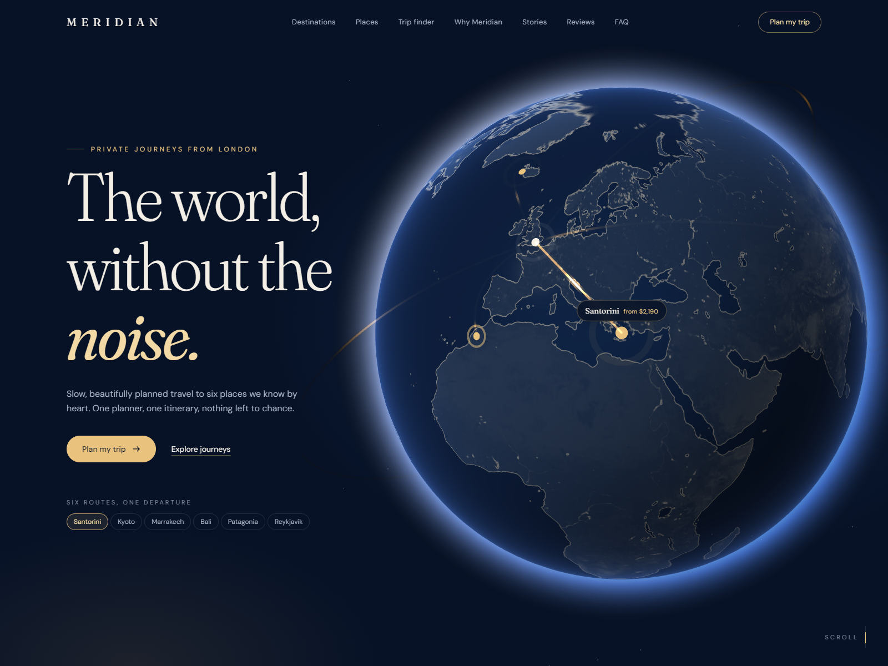

# MERIDIAN — Journeys, curated.

A portfolio landing page for a fictional luxury travel agency. Cinematic and editorial, built to convert: an interactive WebGL globe, a pinned horizontal destination story, an expanding-panel gallery, a working trip finder, a full journey modal and a validated inquiry form.

**Live:** https://meridian-travel-lilac.vercel.app

> **Demo project.** Meridian, its prices, reviews, statistics and contact details are fictional.



## Stack

- **Next.js 16** (App Router, Turbopack, Cache Components) + **TypeScript**
- **Tailwind CSS v4**
- **React Three Fiber** + **drei** + **three.js** — the hero globe (custom GLSL shaders)
- **GSAP** + **ScrollTrigger** and **Lenis** — pinned horizontal scroll, parallax, scroll-scrubbed reveals, smooth scrolling
- **Framer Motion** — layout animations, modals, accordion, micro-interactions
- Hosted on **Vercel**; every push to `main` deploys to production automatically

## Getting started

```bash
npm install
npm run dev      # http://localhost:3000
npm run build && npm start
npm run lint
```

Requires Node 20+. Optional env var: `NEXT_PUBLIC_SITE_URL` (canonical URL for metadata/sitemap; on Vercel the production domain is used automatically).

## Sections

| # | Section | Highlights |
| --- | --- | --- |
| — | Intro loader | Flight path draws, then a clip-path wipe. Pure CSS/SMIL, so it never waits for JS (≤1.5s on any device) |
| 1 | Hero | R3F globe with custom shaders, atmosphere glow, animated great-circle arcs from London, pulsing pins; drag to rotate; pins and list jump to destinations |
| 2 | Destinations | Pinned horizontal scroll; parallax photo layer, sliding display type; stacked cards on phones / reduced motion |
| 3 | Places | Expanding panels (desktop) with staggered clip-path rise + parallax zoom; snap carousel on mobile |
| 4 | Trip finder | Budget slider, trip length, style chips; filters `src/data/trips.json`; animated layout |
| 5 | Why Meridian | Count-up figures (sample data) |
| 6 | Stories | Postcards that fan out on hover/focus |
| 7 | Reviews | Two-row opposite-direction marquee, pauses on hover; static grid for reduced motion |
| 8 | FAQ | Accessible single-open accordion |
| 9 | Inquiry form | Client + server validation, honeypot, success animation, pre-filled from "Plan this trip" |
| 10 | Footer | Scroll-revealed wordmark, newsletter with validation, back to top |
| — | Journey modal | Day-by-day timeline that draws as you scroll inside it, inclusions, price, "Plan this trip" |

## Structure

```
src/
  app/
    layout.tsx, page.tsx, globals.css   fonts, metadata, page order, design tokens
    api/inquiry/route.ts                trip inquiries (validated, logged)
    api/newsletter/route.ts             newsletter sign-ups (validated, logged)
    opengraph-image.tsx, icon.svg       generated OG card (assets in _og/), favicon
    sitemap.ts, robots.ts               SEO
    terms/, privacy/                    demo legal pages
  components/
    Loader.tsx, Nav.tsx                 intro, nav + mobile menu
    hero/                               hero copy + R3F globe (globe/Globe.tsx, globe/shaders.ts)
    destinations/ places/ finder/ why/ stories/ reviews/ faq/ inquiry/ footer/
    journey/JourneyModal.tsx            shared journey dialog (opened from anywhere)
    providers/Providers.tsx             Lenis + GSAP ticker, scroll lock, journey/plan state
  data/                                 destinations, places, story photos, trips.json (12 trips)
  hooks/useMedia.ts                     reduced motion / breakpoints / intro reveal
  lib/                                  geo maths, inquiry validation, intro timing, events, site URL
public/
  images/places/, images/journeys/      Unsplash photography (see credits)
  textures/                             globe textures (NASA)
scripts/
  portfolio-shots.mjs                   1600×1200 covers → portfolio-assets/
  screenshot.mjs                        ad-hoc headless screenshots
  optimize-textures.mjs                 one-off texture compression
portfolio-assets/                       portfolio cover images
```

## Accessibility & motion

- `prefers-reduced-motion`: no loader, no globe rotation, no parallax or marquee, no pinned scroll; content appears instantly.
- Keyboard: every globe pin has a twin in the hero list; filters are native radios, toggle buttons and a range input; dialogs trap focus, close on Escape and return focus.
- Form errors are announced, linked with `aria-describedby`, and focus moves to the first invalid field.

## Connecting the inquiry form

Submissions are validated in `src/app/api/inquiry/route.ts` (same rules as the client, from `src/lib/inquiry.ts`) and logged — visible in the terminal locally and in **Vercel → Project → Logs** in production. To deliver them by email:

**Resend**

```bash
npm install resend
```

Add `RESEND_API_KEY` (and a verified sender domain) in Vercel, then in the route handler replace the `console.log`:

```ts
import { Resend } from "resend";
const resend = new Resend(process.env.RESEND_API_KEY);

await resend.emails.send({
  from: "Meridian <inquiries@yourdomain.com>",
  to: "team@yourdomain.com",
  replyTo: inquiry.email,
  subject: `New inquiry: ${inquiry.destination} for ${inquiry.travelers}`,
  text: JSON.stringify(inquiry, null, 2),
});
```

**Formspree** — create a form, then forward from the route handler:

```ts
await fetch(`https://formspree.io/f/${process.env.FORMSPREE_FORM_ID}`, {
  method: "POST",
  headers: { "Content-Type": "application/json", Accept: "application/json" },
  body: JSON.stringify(inquiry),
});
```

The newsletter route (`src/app/api/newsletter/route.ts`) can be wired the same way, e.g. to Resend Audiences or Mailchimp.

## Notes

- `three` is pinned to **0.182.0**: from r183 three.js deprecates `THREE.Clock`, which React Three Fiber 9.8 still uses, producing a console warning. Unpin once R3F moves to `THREE.Timer`.
- Lighthouse (desktop, production build): Performance 96 · Accessibility 100 · Best Practices 100 · SEO 100 · CLS 0.

## Image credits

All photography from [Unsplash](https://unsplash.com), used under the [Unsplash License](https://unsplash.com/license).

| Place | Photographer | Photo |
| --- | --- | --- |
| Santorini | [James Ting](https://unsplash.com/@jamesting) | [White buildings on Oia cliffside](https://unsplash.com/photos/6N2mSJsKTtA) |
| Santorini | [Albert Canite](https://unsplash.com/@albert_canite) | [Blue-domed church over the Aegean](https://unsplash.com/photos/YlLMQBlJEcY) |
| Kyoto | [zhenzhong liu](https://unsplash.com/@lzzbest) | [Kiyomizu-dera temple](https://unsplash.com/photos/UDvt4755zmo) |
| Kyoto | [Martijn Baudoin](https://unsplash.com/@martijnbaudoin) | [Torii gates, Fushimi Inari](https://unsplash.com/photos/J_wGqRwEUEg) |
| Marrakech | [Oussama Abouchatir](https://unsplash.com/@paradigmvisuals) | [Dar Si Said courtyard](https://unsplash.com/photos/ItHGTRhQkEg) |
| Morocco | [Duane Storey](https://unsplash.com/@duanestorey) | [Camels in Merzouga](https://unsplash.com/photos/dGVWn_XK-hw) |
| Bali | [Niklas Weiss](https://unsplash.com/@treesoftheplanet) | [Rice terraces in Tegallalang](https://unsplash.com/photos/-2WlTWZLnRc) |
| Bali | [Guillaume Marques](https://unsplash.com/@mrqs_g) | [Pura Ulun Danu Bratan](https://unsplash.com/photos/bnMPFPuSCI0) |
| Patagonia | [Marc Thunis](https://unsplash.com/@cyrus_smith) | [Torres del Paine at sunrise](https://unsplash.com/photos/3UY5DMqdJ7o) |
| Patagonia | [Andrew Svk](https://unsplash.com/@andrew_svk) | [Mount Fitz Roy at sunrise](https://unsplash.com/photos/150fZ07GQqs) |
| Reykjavík | [Kari Bjorn Photography](https://unsplash.com/@karibjorn) | [Lighthouse under the aurora](https://unsplash.com/photos/I_Wizf3ugAQ) |
| Iceland | [Owen Roth](https://unsplash.com/@owenroth_v1) | [Black-sand beach, Vík](https://unsplash.com/photos/Od4uus1mwAE) |
| Amalfi Coast | [Letizia Agosta](https://unsplash.com/@adnonda) | [Positano](https://unsplash.com/photos/3TzHmifXX5k) |
| Cappadocia | [Alex Azabache](https://unsplash.com/@alexazabache) | [Balloons over Göreme](https://unsplash.com/photos/UeX_qw9lnzc) |

Globe textures: NASA Visible Earth (Blue Marble water mask, Black Marble city lights), public domain, via the [three-globe](https://github.com/vasturiano/three-globe) examples.

Fonts: [Fraunces](https://fonts.google.com/specimen/Fraunces) and [DM Sans](https://fonts.google.com/specimen/DM+Sans) (SIL Open Font License).
